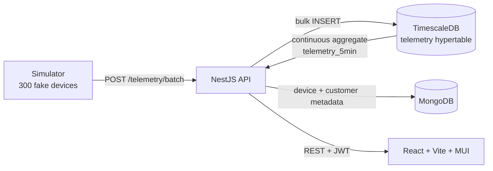

# Fleet Pulse

Open-source device-monitoring dashboard for satellite and cellular links — the kind of NOC
platform an operator watches all day, built end to end on **entirely synthetic data**.

Every device, customer, site and reading in this repo is generated by the simulator. There is no
real network, no real customer and no proprietary data anywhere in it.

## Why it exists

Production monitoring work tends to live behind an NDA. This is the same architecture, built in
the open so the design decisions can actually be read: a dual-database split with time-series
telemetry separated from document metadata, role-scoped access, and a dashboard that stays fast
as telemetry accumulates.

## Architecture



**Why two databases.** Telemetry is append-only, timestamped and always queried by time range —
that is what a hypertable is for. Device and customer records are read and updated individually,
have a shape that changes as the product does, and are never scanned by time. Forcing both into
one store means either time-series queries that degrade as rows pile up, or rigid metadata.

**Why a hypertable.** It shards `telemetry` into per-day chunks, so "last 6 hours" touches one
chunk instead of the whole table. Chunks older than a week compress automatically.

**Why a continuous aggregate.** The trend chart reads `telemetry_5min`, which Timescale keeps
current incrementally. The chart costs the same whether there are 1M rows or 100M.

## Running it

Needs Docker and Node 20+.

```bash
docker compose up -d                 # TimescaleDB (:5433) + MongoDB (:27018)
cd backend   && npm install && npm run start:dev
cd simulator && npm install && npm start -- --backfill 6h
```

The backfill writes ~1.3M samples of history, then the simulator keeps ticking live every 5s.
Drop `--backfill` to start from empty.

| Variable | Default | What it does |
|---|---|---|
| `DEVICE_COUNT` | `300` | Devices in the fake fleet |
| `TICK_MS` | `5000` | Milliseconds between telemetry ticks |
| `API_URL` | `http://localhost:3000` | Where the simulator posts |

## Layout

```
simulator/   fake fleet + telemetry generation, posts batches to the API
backend/     NestJS — ingestion, queries, auth (milestone 2)
db/init/     Timescale schema: hypertable, compression, continuous aggregate
```

## Tests

```bash
cd simulator && npm test
```

Covers the parts where a silent bug would go unnoticed: outages lasting multiple ticks rather
than flapping every sample, readings drifting rather than teleporting, and offline samples
carrying `null` instead of `0` — an offline device has no reading, which is not the same as a
reading of zero, and averaging the two differently gives different availability numbers.

## Status

- [x] **1 — simulator + ingestion**: fake fleet, telemetry generation, bulk ingest, hypertable
- [ ] **2 — API + auth**: JWT, roles (admin / customer / viewer), customer-scoped queries
- [ ] **3 — dashboard**: online/offline trend, availability %, device table
- [ ] **4 — map + drilldown**: Leaflet markers, per-device signal chart
- [ ] **5 — README + tests**: screenshot, RBAC and ingestion tests

## License

MIT
