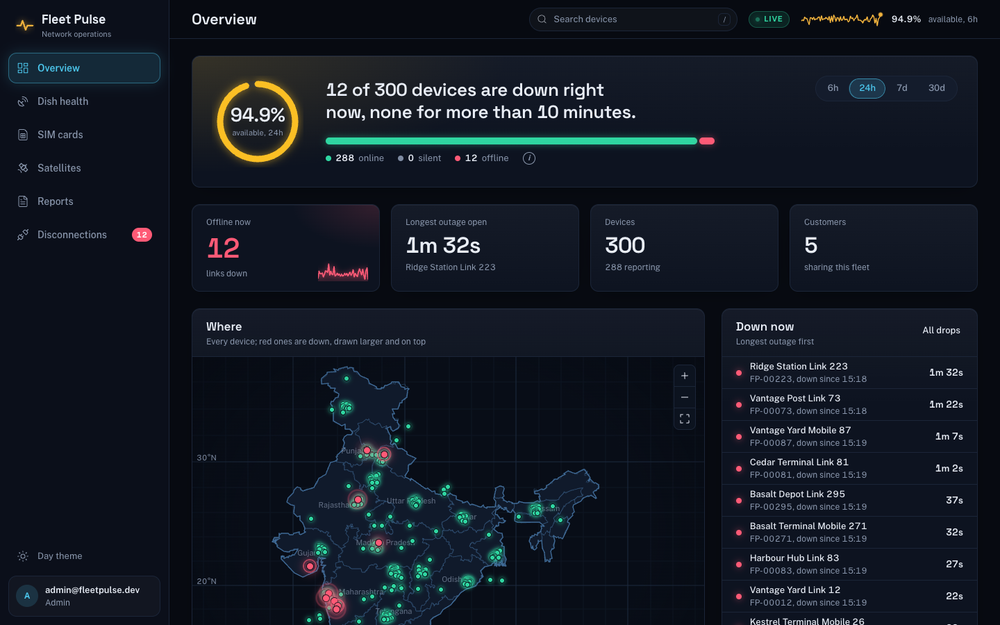
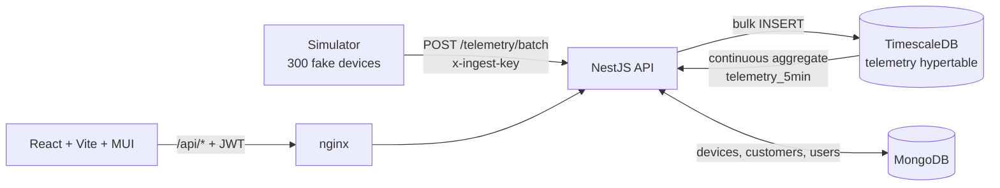
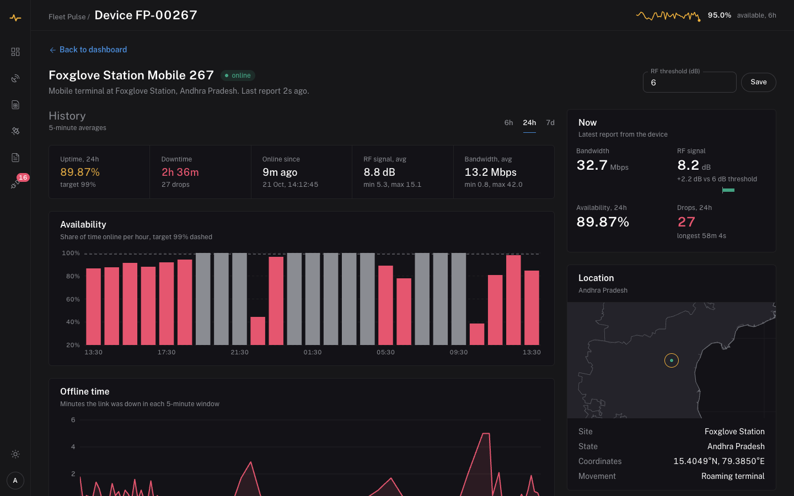
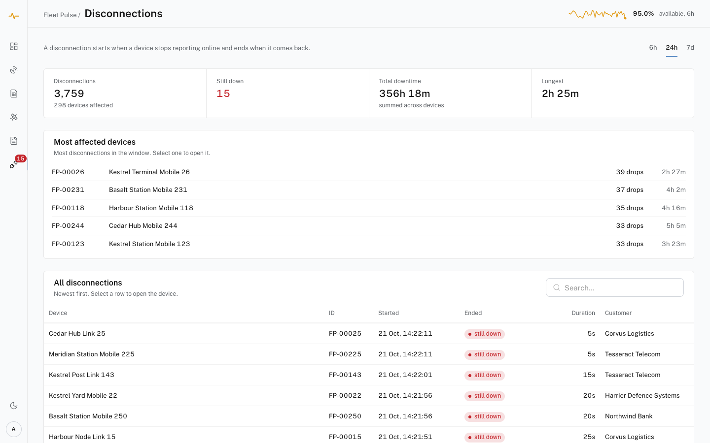

# Fleet Pulse

Open-source device-monitoring dashboard for satellite and cellular links — the kind of NOC
platform an operator watches all day, built end to end on **entirely synthetic data**.

**Live demo: https://fleetpulse.solarkb.com** (demo accounts below, or add `?demo=admin` to the address)



Every device, customer, site and reading in this repo is generated by the simulator. There is no
real network, no real customer and no proprietary data anywhere in it.

## Quick start

Needs Docker.

```bash
docker compose up --build
```

Open **http://localhost:8080** and sign in with one of the demo accounts below (the login screen
has buttons for them). On first start the simulator writes 6 hours of history for 300 devices
(~1.3M samples, about a minute), then keeps reporting live every 5 seconds.

| Email | Password | Role | Sees |
|---|---|---|---|
| `admin@fleetpulse.dev` | `fleetpulse` | admin | every customer; can edit devices |
| `viewer@fleetpulse.dev` | `fleetpulse` | viewer | every customer, read-only (a NOC operator's seat) |
| `northwind@fleetpulse.dev` | `fleetpulse` | customer | Northwind Bank's devices only, read-only |

Or skip the form: `http://localhost:8080/?demo=admin` (or `viewer`, `customer`) signs straight into that account and works with any screen, e.g. `/?demo=viewer#/disconnections`.

`docker compose down -v` stops it and deletes the data.

## Why it exists

Production monitoring work tends to live behind an NDA. This is the same architecture, built in
the open so the design decisions can actually be read: a dual-database split with time-series
telemetry separated from document metadata, role-scoped access, and a dashboard that stays fast
as telemetry accumulates.

## Architecture



**Why two databases.** Telemetry is append-only, timestamped and always queried by time range —
that is what a hypertable is for. Device and customer records are read and updated individually,
have a shape that changes as the product does, and are never scanned by time. Forcing both into
one store means either time-series queries that degrade as rows pile up, or rigid metadata.

**Why a hypertable.** It shards `telemetry` into per-day chunks, so "last 6 hours" touches one
chunk instead of the whole table. Chunks older than a week compress automatically.

**Why a continuous aggregate.** Every chart reads `telemetry_5min`, which Timescale keeps current
incrementally, so a chart costs the same at 1M rows or 100M. It runs in real-time mode: buckets
the refresh policy hasn't reached yet are computed from raw rows at query time, so the newest
point is never stale. The policy window is six days rather than an hour, so backfilled history
gets materialised too.

**Why disconnections have their own table.** Working out every outage from raw rows means a
window-function pass over every sample: 5.2M rows and 6 seconds for a day. Instead, ingestion
compares each sample with the device's last known state and writes only the changes to
`link_events` (~12,000 a day), so the disconnections page reads a few thousand rows in under
100 ms, for a week as cheaply as for an hour.

**Why status comes from raw rows.** The device table needs each device's latest sample, current
to the tick. `DISTINCT ON (device_id)` over the `(device_id, time DESC)` index, bounded to the last
hour, reads one chunk. A device silent for 2 minutes is `unknown`, not `online`: its last sample
says nothing about now.



## What's in the app

| Section | What it answers |
|---|---|
| Dashboard | How many devices are up right now, availability over the window, where the outages are on the map |
| Dish | Which dishes report online but sit below their RF threshold (alignment, obstruction, rain fade) |
| SIM | Which terminals carry a cellular backup SIM, on which carrier and plan |
| Satellite | How each satellite and beam is doing, so a beam-wide problem stands out from a site problem |
| Reports | CSV downloads: availability by device, disconnections, device inventory |
| Disconnections | Every outage with start, end and duration, and the devices that drop most |
| Profile | Who you're signed in as, what your role can see and change, when the session ends |

Day and night themes: the sun/moon button in the sidebar switches them, the choice is remembered, and the first visit opens in night mode.

The look is an operations-centre style built for long sessions: a deep blue-black ground, panels that catch a little light, Space Grotesk for titles and big figures, a labelled sidebar with a live badge, and colour that means something: green, red and amber are status, cyan marks selection. Night is the default, with a matching day theme (the map switches with it). An earlier design from a Claude Design handoff is kept in `docs/design/` for reference.



## API

Every route needs `Authorization: Bearer <token>` except login, health and ingestion.

| Route | Who | What |
|---|---|---|
| `POST /auth/login` | anyone | `{ email, password }` → JWT, valid 8h |
| `GET /auth/me` | any role | the signed-in user |
| `GET /fleet/summary?hours=24` | any role | online / offline / unknown counts now, availability %, 5-min trend |
| `GET /devices?customerId=&status=` | any role | devices with live status, last reading, last seen |
| `GET /devices/:id` | any role | one device |
| `GET /devices/:id/telemetry?hours=24` | any role | 5-min availability, bandwidth and RF history |
| `PATCH /devices/:id` | admin | `{ name?, rfThreshold? }`, nothing else is editable |
| `GET /customers` | any role | customers visible to the caller |
| `GET /disconnections?hours=24` | any role | outages in the window: start, end (null while down), duration |
| `GET /reports/availability?hours=24` | any role | per-device availability, downtime minutes, average bandwidth and RF |
| `POST /telemetry/batch` | simulator | `x-ingest-key` header, up to 5000 samples |
| `GET /health` | anyone | liveness for compose and deploys |

**Every route is protected by default.** The JWT guard is global; a route opts out with
`@Public()`. Forgetting a decorator fails closed instead of leaking data.

**Customer scoping happens in one function** (`customerScope` in `devices.service.ts`). Every
query, Mongo or Timescale, starts from the device set it allows, so a customer asking for
`?customerId=someone-else` still gets only its own devices, and another customer's device id
returns 404 rather than 403, so the API doesn't confirm it exists.

**Passwords** are hashed with Node's built-in scrypt. Login gives the same error, in the same
time, for an unknown email and a wrong password.

## Developing

Run the databases in Docker and the apps with hot reload. Needs Node 20+.

```bash
docker compose up -d timescale mongo          # TimescaleDB :5433, MongoDB :27018
cd backend   && npm install && npm run start:dev
cd simulator && npm install && npm start -- --backfill 6h
cd frontend  && npm install && npm run dev    # http://localhost:5173, proxies /api to :3000
```

| Variable | Default | What it does |
|---|---|---|
| `DEVICE_COUNT` | `300` | Devices in the fake fleet |
| `TICK_MS` | `5000` | Milliseconds between telemetry ticks |
| `API_URL` | `http://localhost:3000` | Where the simulator posts |
| `INGEST_KEY` | `dev-ingest-key` | Shared key on `POST /telemetry/batch`; same value on both sides |
| `JWT_SECRET` | `dev-only-jwt-secret` | Signs login tokens. **Required** when `NODE_ENV=production` |
| `DEMO_PASSWORD` | `fleetpulse` | Password for the seeded demo accounts |

The backfill only runs into an empty fleet, so restarting the simulator never writes the same
history twice.

```
simulator/   fake fleet + telemetry generation, posts batches to the API
backend/     NestJS: ingestion, auth + roles, device and fleet queries
frontend/    React + Vite + MUI: dashboard, Leaflet map, per-device page. Routes are hash-based
             (#/devices/FP-00042), so any static server can host the build
db/init/     Timescale schema: hypertable, compression, continuous aggregate, link events
```

## Tests

```bash
cd simulator && npm test             # telemetry generation
cd backend   && npm test             # ingestion validation and batching
cd backend   && npm run test:e2e     # auth and scoping, against the real databases
```

Each suite covers what a bug would break silently:

- **Simulator** — outages last several ticks instead of flapping every sample, readings drift
  instead of teleporting, and an offline sample carries `null`, never `0`. An offline device has
  no reading, which is not a reading of zero; averaging them differently gives a different
  availability number.
- **Ingestion** — malformed samples are rejected with the offending index, a large batch is
  split into multi-row inserts that stay under Postgres's 65,535 bind-parameter limit, and only
  changes of state become link events (a device first seen offline counts as an outage in progress).
- **Auth and scoping** (needs `docker compose up -d timescale mongo`; uses its own Mongo database
  and `TEST-` device ids, cleaned up afterwards) — no token or a forged one is rejected, a wrong
  password and an unknown email look identical, a customer can't reach another customer's devices
  by list, id, telemetry, summary, disconnections or report, a viewer can't edit, an admin can
  edit only the allowed fields, ingestion refuses a missing or wrong key, and an outage posted
  through ingestion comes back as one disconnection with the right duration.

## Deploying to a server

Any Linux server with Docker works (Oracle Cloud's Always Free Arm VM, an EC2 instance, a VPS);
every image has an `arm64` build. `docker-compose.prod.yml` layers the production differences on
top of the normal file:

- only **Caddy** is reachable from the internet; it serves **HTTPS** with an automatic
  Let's Encrypt certificate, or plain HTTP on port 80 until a domain is set;
- the databases, the API and the frontend have **no published ports**;
- **secrets are required**: compose refuses to start without them, and the API refuses to start
  in production without them;
- sign-in is **rate-limited** to 10 attempts a minute per address (nginx `limit_req`);
- everything is **kept 30 days** (raw telemetry, 5-minute rollups and outage events), then deleted automatically, so the disk never fills. Screens and reports offer up to 30 days.

```bash
# on the server, with Docker and the compose plugin installed
git clone https://github.com/<you>/fleet-pulse.git && cd fleet-pulse
cp .env.example .env          # then fill it in: openssl rand -hex 32 for each secret
docker compose -f docker-compose.yml -f docker-compose.prod.yml up -d --build
```

Open ports 80 and 443 in the cloud firewall. On Oracle Cloud that is two places: the subnet's
security list, and the VM's own `iptables` rules. Once the domain's A record points at the
server, set `DOMAIN=` in `.env` and run the same command again; Caddy gets the certificate itself.

## Not in v1

Deliberately left out, with where each would go:

- **Pagination** on `/devices`. Fine for a few hundred devices; past a few thousand it needs a
  cursor.
- **User management.** Demo accounts are seeded; there is no UI or API to create users.
- **Alerting.** The data for "device offline for 10 minutes" is there; nothing notifies anyone yet.
- **Multiple API instances.** Link events rely on each device's last state held in the API process.
  A second instance would need that state in Redis, or the comparison done in SQL at insert time.

## License

[MIT](LICENSE)
